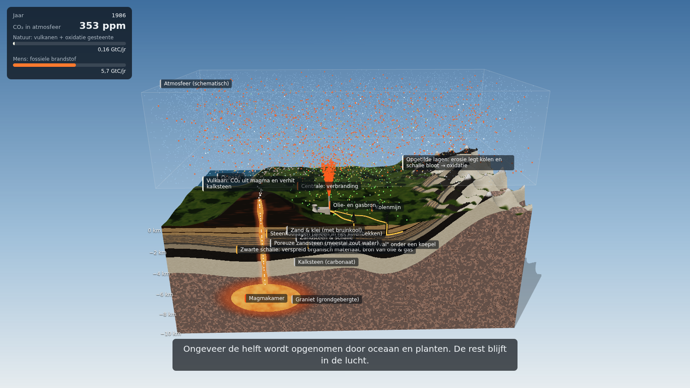

# Koolstof: van gesteente naar lucht

Interactieve 3D-animatie over de koolstofkringloop en de opwarming van de aarde.
Een doorsnede van 30 × 16 km en 10 km diep laat zien hoe koolstof eeuwenlang
langzaam in de bodem is opgeslagen, hoe de natuur er heel langzaam een beetje
van teruggeeft (vulkanen, oxidatie van opgetilde gesteentelagen) en hoe de mens
sinds 1850 diezelfde koolstof gericht naar boven haalt en verbrandt.

**▶ [Bekijk de animatie online](https://anneb.github.io/globalwarming/)**

[](https://anneb.github.io/globalwarming/)

## Wat je ziet

- **Seizoenen**: planten nemen in de zomer CO₂ op en geven het in de winter terug
  (de "zaagtand" van de Keeling-curve, ±3 ppm). Netto nul. Zichtbaar bij een
  lage snelheid (< 1 jaar per seconde).
- **Langzame geologische kringloop**: ~0,16 miljard ton koolstof per jaar komt
  terug via vulkanen en via oxidatie van kolen- en schalielagen die door
  gebergtevorming en erosie aan de oppervlakte komen.
- **Fossiele brandstoffen**: steenkoollagen in een kolenbekken, olie en gas
  alleen in "vallen" (koepels onder een afsluitende laag).
- **De mens grijpt in (1850 →)**: kolenmijn en oliebron, verbranding in een
  centrale, ~10 miljard ton koolstof per jaar: 60–100× de natuurlijke uitstoot.
- **Wat blijft er in de lucht?** Opname door oceaan en land volgens het
  Bern-koolstofmodel (IPCC), gekalibreerd op de gemeten CO₂-concentratie.
- **Scenario's na 2025**: zoals nu doorgaan, afbouwen naar nul in 2050, of
  direct stoppen. Ook bij nul uitstoot daalt de CO₂ maar langzaam.

Elke stip ≈ 50 miljoen ton koolstof. Laagdiktes, vulkaan en installaties zijn
overdreven groot zodat ze zichtbaar zijn.

## Zelf draaien

```bash
cd web
npm install
npm run dev
```

Video renderen (frame voor frame, deterministisch, met ffmpeg):

```bash
npm run record -- --seconds 82 --w 1920 --h 1080 --out ../video/koolstofblok.mp4
```

Meer over de opbouw van de code: [`web/README.md`](web/README.md).
Getallen en bronnen: [`docs/wetenschap-koolstofkringloop.md`](docs/wetenschap-koolstofkringloop.md).

## Gemaakt met

[Three.js](https://threejs.org/), [Vite](https://vite.dev/),
[Playwright](https://playwright.dev/) en ffmpeg, samen met Claude Code.
